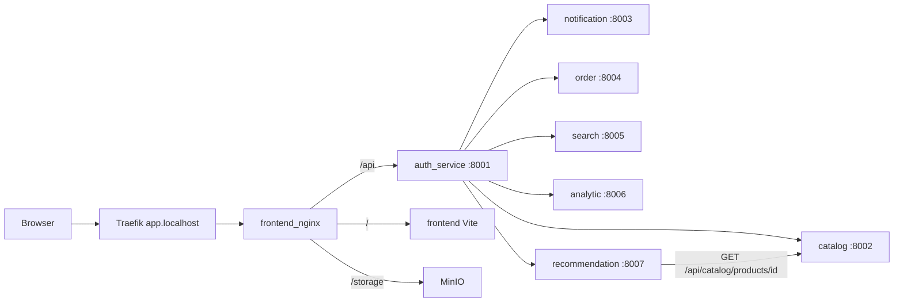

# php-project

Интернет-магазин из нескольких сервисов. Витрина, каталог, заказы со Stripe, поиск, ассистент, письма и аналитика. Браузер открывает только `https://app.localhost`: страницы отдаёт frontend, `/api` идёт в `auth_service`. Там проверяется JWT, и запрос проксируется дальше.

Сервисы не торчат на хост. Они сидят в сети `php_project_net` и обмениваются событиями через Kafka.

Подробная схема: [docs/architecture.md](docs/architecture.md). Почему так сделано: [docs/adr](docs/adr/README.md).

## Сервисы

| Сервис | Порт | Роль |
|--------|------|------|
| [frontend](frontend/) | Vite `5173`, edge nginx `80` | SPA. Браузер ходит только сюда |
| [auth_service](auth_service/README.md) | `8001` | JWT, роли и API gateway |
| [catalog_service](catalog_service/README.md) | `8002` | Товары, категории, магазины, остатки, Filament |
| [notification_service](notification_service/README.md) | `8003` | Письма по событиям, журнал отправок |
| [order_service](order_service/README.md) | `8004` | Заказы, оплата Stripe, saga остатков |
| [search_service](search_service/README.md) | `8005` | Поиск и autocomplete (OpenSearch) |
| [analytic_service](analytic_service/README.md) | `8006` | Агрегаты в ClickHouse, read-only API |
| [recommendation_service](recommendation_service/README.md) | `8007` | Ассистент: локальный pgvector + Gemini |

Карточки с зависимостями, переменными и командами тестов: [docs/services](docs/services/README.md).

## Как сервисы общаются

Два канала: синхронный HTTP через gateway и асинхронные события в Kafka. Тип события — header `event-type`. Та же схема с базами и топиками: [docs/architecture.md](docs/architecture.md).

### HTTP



Браузер открывает `app.localhost`. [`frontend/nginx.conf`](frontend/nginx.conf) режет трафик так: `/api` → `auth_service_app:8001`, `/` → Vite, `/storage` → MinIO (картинки каталога).

JWT и роли проверяет только auth. [`ProxyService`](auth_service/app/Services/Gateway/ProxyService.php) проксирует запрос и вшивает `X-User-Id` / `X-User-Role` (для заказов ещё `user_id` в body и query). Маршруты — [`auth_service/routes/api.php`](auth_service/routes/api.php):

| Кто | Пути gateway |
|-----|----------------|
| без JWT | login, registration, refresh, Stripe webhook, search, recommendations health |
| любой пользователь | `/api/catalog`, `/api/orders`, `/api/recommendations` |
| admin и analyst | `/api/notifications`, `/api/admin/orders`, `/api/analytics` |
| admin | users/roles, catalog admin, upload, Filament `/admin-catalog`, recommendations reindex |

Прямой HTTP между сервисами, минуя gateway, один: recommendation → catalog `GET /api/catalog/products/{id}` ([`HttpCatalogProductClient`](recommendation_service/app/Services/Catalog/HttpCatalogProductClient.php)) — проверка, что карточка ещё опубликована. Поиск и индекс ассистента живут локально (OpenSearch и pgvector), не live-запросами в каталог.

### Kafka

| Топик | Кто пишет | Кто читает |
|-------|-----------|------------|
| `user.events` (`user.registered`) | auth, outbox | notification (письмо), analytic |
| `product.events` (`product.created`, `product.updated`, `product.deleted`, `product.published`, `product.unpublished`) | catalog, outbox | order (snapshots: created/updated), search, recommendation, analytic (created/updated) |
| `category.events` (`category.created`, `category.updated`, `category.deleted`) | catalog, outbox | search |
| `stock.events` (`stock.reserved`, `stock.reservation_failed`) | catalog, outbox | order |
| `catalog.events` (`stock.changed`) | catalog, outbox | search, recommendation |
| `order.events` | order, outbox | catalog (`order.created`, `stock.release_requested`, `stock.commit_requested`), notification (`order.paid`, `order.confirmed`, `order.cancelled`), analytic (`order.created`, `order.paid`, `order.shipped`, `order.cancelled`) |
| `search.events` (`search.performed`) | search, outbox | analytic |
| `user.events.dlq`, `order.events.dlq` | notification | — |

`order.confirmed` читает только notification. `order.shipped` читает только analytic и пишет его как стадию `completed`. Catalog оба типа пропускает.

Все исходящие события пишутся в DBAL-канал `kafka-outbox` в той же транзакции, что и домен, и уходят воркером `php artisan ecotone:run kafka-outbox`. Входящие сообщения сначала попадают в `inbox`, затем их разбирает `php artisan ecotone:run inbox`.

### Вне стека

| Система | Куда |
|---------|------|
| Stripe | webhook на gateway → order |
| Gemini | embed и ответы ассистента в recommendation |
| Mailpit | исходящая почта notification |

## Документация API

Swagger UI: [https://app.localhost/docs/](https://app.localhost/docs/) (стек должен быть запущен). Спека всех публичных JSON API — [`auth_service/public/docs/openapi.yaml`](auth_service/public/docs/openapi.yaml). Оглавление текстовой документации: [docs/README.md](docs/README.md).

---

# Запуск

```bash
./scripts/bootstrap.sh
docker compose up -d --build
./scripts/test-all.sh
./scripts/lint-all.sh
./scripts/demo-prep.sh
```

`bootstrap.sh` копирует `.env.example` → `.env` (если файла ещё нет), генерирует пустые `APP_KEY` и ставит PHP `vendor/` через Docker. Пароли БД/Redis/MinIO/ClickHouse уже с локальными дефолтами — их обычно трогать не нужно.

Laravel HTTP-контейнеры (`*_app`) слушают свои порты через **nginx + php-fpm** (общий образ `php-project-php-base:8.5`). Kafka/scheduler/outbox в тех же образах запускают `php artisan …` через CLI. Edge `frontend_nginx` / Traefik без изменений.

Логи, Mailpit, ClickHouse и CI: [docs/infrastructure.md](docs/infrastructure.md).

## Секреты (заполнить вручную)

Реальные ключи **не** лежат в репозитории (только в локальных `.env` и в GitHub Actions secrets). После bootstrap отредактируй:

| Переменная | Файл | Обязательно? | Как получить |
|------------|------|--------------|--------------|
| `JWT_SECRET` | `auth_service/.env` | Да (логин / gateway) | `openssl rand -hex 32` |
| `STRIPE_SECRET` | `order_service/.env` | Для оплаты и Stripe integration-тестов | Stripe Dashboard → test mode → Secret key (`sk_test_…`) |
| `STRIPE_WEBHOOK_SECRET` | `order_service/.env` | Для вебхуков и тех же тестов | вывод `stripe listen` (`whsec_…`) |
| `GEMINI_API_KEY` | `recommendation_service/.env` | Для ассистента / demo / Gemini-тестов | [Google AI Studio](https://aistudio.google.com/apikey) |

Какие ещё переменные нужны каждому сервису: [docs/services](docs/services/README.md).

Пример:

```bash
# auth
openssl rand -hex 32   # вставить в auth_service/.env → JWT_SECRET=...

# Stripe (отдельная консоль; держать запущенным при оплате)
stripe login
stripe listen --forward-to https://app.localhost/api/webhooks/stripe \
  --events checkout.session.completed,checkout.session.expired \
  --skip-verify
# whsec_… → order_service/.env → STRIPE_WEBHOOK_SECRET=
# sk_test_… → order_service/.env → STRIPE_SECRET=

# после правки Stripe/JWT:
docker compose up -d --force-recreate order_app auth_app
```

Без Stripe стек и юнит-тесты работают; `./scripts/test-all.sh` упадёт на order integration, пока ключи не заданы. Без Gemini ассистент пустой, Gemini-тесты skip.

## Полезные команды

```bash
# весь стек
docker compose up -d --build

# тесты / линт (контейнеры уже должны быть up)
./scripts/test-all.sh              # все сервисы
./scripts/test-all.sh order auth   # фильтр по имени

# сиды / демо-данные (нужен GEMINI_API_KEY для recommendation)
./scripts/demo-prep.sh
```

Для CI задай repository secrets: `JWT_SECRET`, `STRIPE_SECRET`, `STRIPE_WEBHOOK_SECRET`, `GEMINI_API_KEY`. Джобы lint, test и deploy: [docs/infrastructure.md](docs/infrastructure.md) и [`.github/workflows/deploy.yml`](.github/workflows/deploy.yml).
