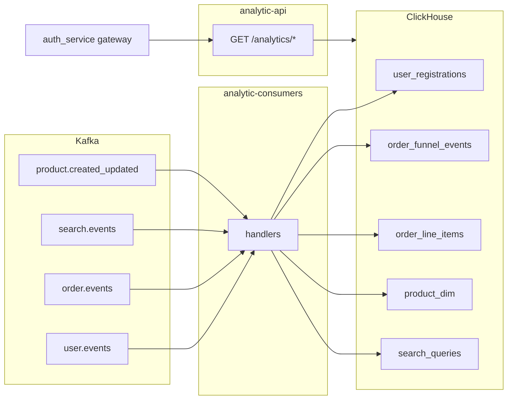

# Analytic Service

Go-микросервис аналитики: **принимает доменные события из Kafka**, пишет их в **ClickHouse**, и отдаёт **read-only HTTP API** с агрегатами для админ-панели (пользователи, воронка заказов, поиск, разрезы по магазинам/категориям).

Внешний доступ идёт через `auth_service` (JWT + роли `admin` / `analyst`). Сам analytic API внутри Docker-сети аутентификацию не проверяет.

## Архитектура



Два бинарника из одного образа (`Dockerfile`):

| Бинарник | Entry | Роль |
|----------|-------|------|
| `analytic-api` | `cmd/api` | HTTP на `:8006` |
| `analytic-consumers` | `cmd/consumers` | Kafka consumer groups → ClickHouse |

Общий старт (config → EnsureDatabase → Connect → Migrate → `store.New`) вынесен в `internal/bootstrap.OpenStore`.

### Пакеты

| Пакет | Назначение |
|-------|------------|
| `internal/config` | Env-конфиг (`CLICKHOUSE_*`, Kafka, HTTP) |
| `internal/bootstrap` | Общий bootstrap API и consumers |
| `internal/clickhouse` | Connect, create DB, SQL-миграции |
| `internal/store` | Inserts + метрики (ClickHouse) |
| `internal/httpapi` | HTTP handlers; зависит от интерфейса `MetricsReader` |
| `internal/kafka` | Consumers; узкие write-порты (`UserRegistrar`, `OrderIngester`, …) |
| `internal/testutil` | Хелперы для integration-тестов |

## Compose-сервисы

Из [`compose.yml`](compose.yml) (подключается корневым `compose.yml`):

- `analytic_clickhouse` — ClickHouse 24.8, HTTP `:8123` на хост, native `9000` только во внутренней сети
- `analytic_api` — контейнер `analytic_service_api`, expose `8006`
- `analytic_consumers` — контейнер `analytic_service_consumers`

Сеть: `php_project_net`. Зависимости: ClickHouse healthy; consumers ещё ждут healthy Kafka.

## Конфигурация

См. [`.env.example`](.env.example).

| Переменная | По умолчанию | Описание |
|------------|--------------|----------|
| `HTTP_ADDR` | `:8006` | Listen address API |
| `KAFKA_BROKERS` | `kafka:29092` | CSV брокеров |
| `CLICKHOUSE_ADDR` | `analytic_clickhouse:9000` | Native protocol |
| `CLICKHOUSE_DATABASE` | `analytics` | БД |
| `CLICKHOUSE_USER` | `default` | Пользователь |
| `CLICKHOUSE_PASSWORD` | **обязателен** | Пустой пароль → ошибка `config.Load` |
| `CLICKHOUSE_ASYNC_INSERT` | `1` | Server-side буфер INSERT |
| `CLICKHOUSE_WAIT_FOR_ASYNC_INSERT` | `0` | `0` = ack сразу (fire-and-forget); `1` = ждать flush |
| `CLICKHOUSE_ASYNC_INSERT_BUSY_TIMEOUT_MS` | `1000` | Flush по времени (мс) |
| `CLICKHOUSE_ASYNC_INSERT_MAX_DATA_SIZE` | `10485760` | Flush по размеру (байты, 10 МБ) |
| `CLICKHOUSE_ASYNC_INSERT_MAX_QUERY_NUMBER` | `100` | Flush примерно после N INSERT’ов |
| `MIGRATIONS_DIR` | `migrations` | Каталог `.sql` миграций |

Локальный compose подставляет `${CLICKHOUSE_PASSWORD:-analytic_local_secret}` в ClickHouse, API и consumers.

### Async insert (батчинг на стороне CH)

Клиент шлёт мелкие `PrepareBatch` INSERT’ы; ClickHouse склеивает их по `async_insert_*` (session settings на native Connect). При `wait_for_async_insert=0` Kafka commit может пройти до физического flush — при краше CH до сброса пачки возможна потеря уже «принятых» строк. В тестах `testutil` форсирует `wait_for_async_insert=1`.

### Смена пароля на уже созданном volume

Официальный образ ClickHouse применяет `CLICKHOUSE_PASSWORD` при **первой** инициализации data directory. Если volume уже создан без пароля (или со старым), пересоздайте:

```bash
docker compose down
docker volume rm php-project_analytic_chdata   # имя может отличаться — проверьте docker volume ls
docker compose up -d analytic_clickhouse analytic_api analytic_consumers
```

После recreate volume ClickHouse пустой, а **Kafka consumer groups сохраняют offsets**. Если consumers поднялись в «залипшем» состоянии (в группе, но `#PARTITIONS=0` — ничего не пишется в CH), перезапустите их:

```bash
docker compose restart analytic_consumers
```

Проверка: `kafka-consumer-groups.sh --describe --group analytic-service-search-v3` должен показать topic/partition и `LAG`. Новые события после успешного assignment снова попадут в ClickHouse; для полного replay истории нужен reset offsets на earliest (или новый group id).

## Kafka: топики и consumer groups

| Group ID | Topics | Обрабатываемые события | Таблица(ы) |
|----------|--------|------------------------|-----------|
| `analytic-service-users-v3` | `user.events` | `user.registered` | `user_registrations` |
| `analytic-service-orders-v5` | `order.events` | `order.created`, `order.paid`, `order.shipped`, `order.cancelled` | `order_funnel_events`, `order_line_items` (только на `created`) |
| `analytic-service-search-v3` | `search.events` | `search.performed` | `search_queries` |
| `analytic-service-products-v1` | `product.created`, `product.updated` | те же типы | `product_dim` |

Семантика доставки:

- `StartOffset: FirstOffset`, ручной commit после успешного handle.
- При ошибке handler — retry той же message (1s backoff), следующая не fetch'ится.
- Невалидный JSON — warn + skip (`return nil` → commit).
- Тип события: header `event-type`, иначе поля body `event_type` / `event`.
- Search: header/body `skip-analytics` пропускает запись.
- `order.shipped` в ClickHouse пишется как `event_type = completed` (стадия воронки).

На `order.created` дополнительно пишутся line items; недостающие store/category имена подтягиваются из `product_dim` (`LookupProductDim`).

## ClickHouse: схема

Миграции в [`migrations/`](migrations/) — idempotent `CREATE` / `ALTER IF NOT EXISTS`, выполняются при каждом старте API и consumers.

Движок: **ReplacingMergeTree**. Чтение метрик идёт с **`FINAL`**.

| Таблица | ORDER BY | Содержимое |
|--------|----------|------------|
| `user_registrations` | `(user_id)` | Регистрации (email, name, …) |
| `order_funnel_events` | `(order_id, event_type)` | Стадии: created / paid / completed / cancelled |
| `order_line_items` | `(order_id, product_id, store_id)` | Позиции заказа + store/category |
| `product_dim` | `(product_id)` | Справочник product → store/category |
| `search_queries` | `(kafka_topic, kafka_partition, kafka_offset)` | Поисковые запросы |

### Воронка заказов

Когорта: заказы с `event_type = 'created'` в диапазоне дат.

Исходы по заказу (после агрегации всех событий):

- **cancelled** побеждает **paid** (если оба были — считается cancelled);
- **open** — ни paid, ни cancelled;
- **completed** считается отдельно (`has_completed`, из `order.shipped`).

Конверсии: `paid/created`, `cancelled/created`. Выручка и AOV — по событиям `paid` в диапазоне.

## HTTP API

Базовый URL внутри сети: `http://analytic_service_api:8006`.  
Снаружи (через gateway): `GET /api/analytics/...` на auth_service (прокси на этот сервис).

Общие query-параметры дат:

- `from`, `to` — опционально;
- формат `YYYY-MM-DD` (UTC) или RFC3339;
- для date-only `to` конец **исключительный** (дата + 24h).

| Method | Path | Параметры | Ответ |
|--------|------|-----------|--------|
| `GET` | `/healthz` | — | `{status}` (+ error при CH ping fail) |
| `GET` | `/analytics/users` | `from`, `to` | `total_users`, `growth[]` |
| `GET` | `/analytics/orders` | `from`, `to` | funnel, conversions, revenue, AOV |
| `GET` | `/analytics/orders/stores` | `from`, `to`, `store_id?`, `limit` (1–100, def 20) | ranking или detail + options |
| `GET` | `/analytics/orders/categories` | `from`, `to`, `category_id?`, `limit` | то же для категорий |
| `GET` | `/analytics/search` | `from`, `to`, `limit` | объём, zero-result rate, top queries |

## Локальный запуск

Из корня монорепо:

```bash
# поднять стек (включая analytic_*)
docker compose up -d analytic_clickhouse analytic_api analytic_consumers

# ClickHouse Play (нужен пароль пользователя)
# http://localhost:8123/play  или  http://clickhouse.localhost/play
```

Сборка образа локально:

```bash
docker compose build analytic_api
```

Нативная разработка (нужны доступные Kafka + CH):

```bash
cd analytic_service
cp .env.example .env   # задайте CLICKHOUSE_PASSWORD
export $(grep -v '^#' .env | xargs)
go run ./cmd/api
go run ./cmd/consumers
```

## Lint

Нужны host Go 1.23+ и [golangci-lint](https://golangci-lint.run/) v1.64.x. Конфиг: [`.golangci.yml`](.golangci.yml).

```bash
# из корня репозитория
./scripts/lint-all.sh analytic
./scripts/lint-all.sh --fix analytic   # gofmt/goimports и другие автофиксы

# или напрямую
cd analytic_service
golangci-lint run ./...
golangci-lint run --fix ./...
```

В CI (`deploy.yml` job lint) analytic прогоняется вместе с Laravel через `./scripts/lint-all.sh --no-fix`.

## Тесты

```bash
cd analytic_service
go test ./...

# integration (нужен ClickHouse на native-порту)
# из корня: docker compose -f compose.yml -f analytic_service/compose.test.yml up -d analytic_clickhouse
CLICKHOUSE_ADDR=localhost:19000 \
CLICKHOUSE_PASSWORD=analytic_local_secret \
CLICKHOUSE_DATABASE=analytics_test \
go test -tags=integration ./internal/kafka/...
```

Корневой [`scripts/test-all.sh`](../scripts/test-all.sh) гоняет analytic-тесты в Docker-сети с тем же паролем.

## Trust model (кратко)

- Публичный путь: JWT + роли в `auth_service`.
- East-west: любой контейнер в `php_project_net` может дернуть `:8006` напрямую.
- ClickHouse HTTP на хосте защищён паролем пользователя; не оставляйте пустой `CLICKHOUSE_PASSWORD`.
