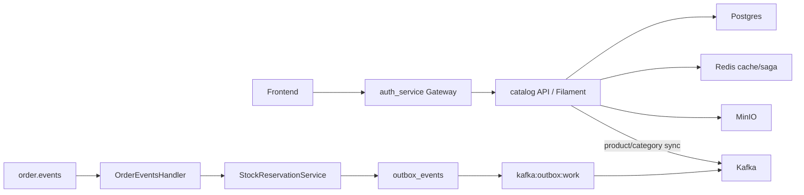
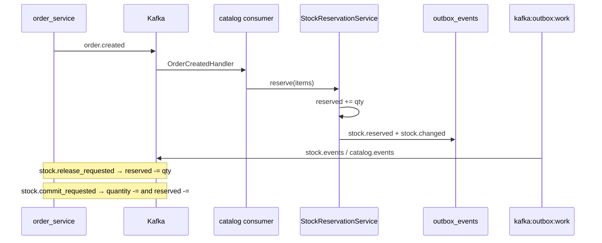

# Catalog service

Laravel-микросервис **товарного каталога**: products, categories, stores, stock, AI-publish flag, Filament-админка и Kafka-синхронизация с остальными сервисами (recommendation, orders).

---

## Общая архитектура



Ключевые файлы:

- Products: [`app/Services/ProductService.php`](app/Services/ProductService.php)
- Categories: [`app/Services/CatalogService.php`](app/Services/CatalogService.php)
- Stock admin: [`app/Services/StockService.php`](app/Services/StockService.php)
- Stock saga: [`app/Services/StockReservationService.php`](app/Services/StockReservationService.php)
- Outbox: [`app/Services/OutboxWriter.php`](app/Services/OutboxWriter.php)
- Filament: [`app/Filament/Resources/ProductResource.php`](app/Filament/Resources/ProductResource.php)
- Routes: [`routes/api.php`](routes/api.php)

---

## 1. Цепочка HTTP-запроса

### Frontend / gateway

1. Storefront ходит в gateway: `GET /api/catalog/...` (любая authenticated role).
2. Admin CRUD / upload — только `role:admin`:
   - `ANY /api/admin/{path}` → `{CATALOG}/api/admin/...`
   - `POST /api/get-upload-url` → `{CATALOG}/api/get-upload-url`
   - Filament: `/admin-catalog` → `{CATALOG}/admin-catalog`
3. Gateway после JWT вшивает `X-User-Id`, `X-User-Role`, опционально name/email ([`ProxyService`](../auth_service/app/Services/Gateway/ProxyService.php)).

### Catalog API

Маршруты в [`routes/api.php`](routes/api.php) (префикс Laravel `/api`):

| Зона | Auth на сервисе | Примеры |
|------|-----------------|---------|
| Storefront | нет (периметр — gateway) | `GET /catalog/categories`, `.../products/{id}`, stores |
| Admin | `AuthenticateFromGatewayHeaders` (admin) | `apiResource` products/categories, stocks |
| Upload | тот же middleware | `POST /get-upload-url` |

Filament `/admin-catalog` тоже требует gateway admin headers ([`AdminPanelProvider`](app/Providers/Filament/AdminPanelProvider.php)).

### Ответ клиенту (примеры)

Storefront product list — paginated Eloquent + optional `store` meta.  
Admin create stock:

```json
{ "stock": { "id": 1, "quantity": 12, "reserved": 0, "available": 12, ... } }
```

---

## 2. CRUD и publish (пошагово)

Filament и JSON admin API делят одни и те же application services — одна точка доменных side-effects.

1. **Create/update/delete product** → [`ProductService`](app/Services/ProductService.php) (TX + attributes) → flush Redis tag `products` → `ProductCreated|Updated|Deleted`.
2. Listener [`PublishProductToKafka`](app/Listeners/PublishProductToKafka.php) шлёт событие **синхронно** в Kafka (`product.created` / `updated` / `deleted`).
3. **Toggle AI publish** (`is_published`) → `ProductPublishStateChanged` → topics `product.published` / `product.unpublished` (их ест recommendation indexer).
4. Categories аналогично через [`CatalogService`](app/Services/CatalogService.php) + [`PublishCategoryToKafka`](app/Listeners/PublishCategoryToKafka.php).
5. Stock admin create/update quantity → [`StockService`](app/Services/StockService.php) → `StockChanged` → **outbox** (не sync publish).

Seeders (`ShopSeeder` и т.п.) пишут модели напрямую и **не** эмитят Kafka — для индекса recommendation нужен [`RepublishProductsSeeder`](database/seeders/RepublishProductsSeeder.php) или ручной republish.

---

## 3. Stock saga (резервация)

Семантика полей:

| Поле | Смысл |
|------|--------|
| `quantity` | Физический остаток (admin / seeders; списывается на `stock.commit_requested` после оплаты) |
| `reserved` | Холд под заказы (`+=` на reserve, `-=` на release/commit) |
| `available` | `quantity - reserved` (accessor, не колонка; storefront `status=in_stock`) |

После reserve (`quantity=10`, `reserved=2`, `available=8`):

- **release** (cancel / Stripe session expired): `reserved -=` → available растёт.
- **commit** (успешная оплата): `quantity -=` и `reserved -=` → available не падает ещё раз (уже упал на reserve).



1. Consumer `kafka:consume:order-events` → [`OrderEventsHandler`](app/Kafka/MainHandlers/OrderEventsHandler.php) → `OrderCreatedHandler` / `StockReleaseHandler` / `StockCommitHandler`.
2. [`SagaStepRunner`](app/Services/Saga/SagaStepRunner.php) + [`SagaStepGuard`](app/Services/SagaStepGuard.php): `busy` бросает исключение (без auto-commit потери сообщения); шаг идемпотентен по `saga_id`.
3. [`StockReservationService`](app/Services/StockReservationService.php):
   - reserve: merge duplicate lines → lock rows → проверка `available` → `reserved +=` → events;
   - release: `reserved = max(0, reserved - qty)`;
   - commit: `quantity -= qty`, `reserved = max(0, reserved - qty)`;
   - items: `product_id`/`store_id` ≥ 1, `quantity` ≥ 1, иначе fail/skip.
4. В `stock.changed` в payload `quantity` уходит **available** (чтобы recommendation `in_stock = quantity > 0` оставался корректным).
5. Outbox worker `kafka:outbox:work` публикует строки из `outbox_events`.

---

## 4. Кэш

- Categories list / tree IDs: Redis tags `categories`.
- Product show / category product lists: tags `products` (+ `categories` для листингов).
- Инвалидация: `ProductService::clearProductCache()`, `CatalogService` flush categories при мутациях.

Storefront listing кэширует ключ с hash фильтров ([`CatalogController`](app/Http/Controllers/CatalogController.php)).

---

## 5. Media / upload

- `POST /api/get-upload-url` (admin): presigned PUT в MinIO, TTL 5m.
- Allowlist MIME: `image/jpeg|png|webp|gif`; extension берётся из MIME, не из произвольного filename suffix.
- Public URL: `config('filesystems.media_public_base')` + bucket + path (Traefik `/storage` → MinIO).
- Filament upload идёт через local Livewire temp disk, затем put в S3 ([`ProductResource`](app/Filament/Resources/ProductResource.php)).

---

## 6. Auth trust model

- **На границе:** JWT в `auth_service`; admin-зоны только `role:admin`.
- **На catalog:** admin API, upload и Filament требуют `X-User-Id` (numeric ≥ 1) + `X-User-Role: admin` ([`AuthenticateFromGatewayHeaders`](app/Http/Middleware/AuthenticateFromGatewayHeaders.php)).
- Storefront API на самом сервисе без локальной auth — рассчитан на то, что снаружи его достигает только gateway (compose: app не публикует порт на host).
- Headers доверяются как identity gateway; отдельного shared secret / локальной JWT-проверки в catalog пока нет.

---

## 7. Workers / compose

Из [`compose.yml`](compose.yml):

| Сервис | Команда |
|--------|---------|
| app | nginx + php-fpm (`entrypoint-http.sh`, port 8002) |
| order consumer | `php artisan kafka:consume:order-events` |
| outbox | `php artisan kafka:outbox:work` |

Также Postgres, Redis, MinIO (+ mc bootstrap bucket `media`).

Ключевые env: см. [`.env.example`](.env.example) — DB, Redis, `KAFKA_*`, `AWS_*` / MinIO, `MEDIA_PUBLIC_BASE`, `SESSION_PATH=/admin-catalog`.

---

## 8. Что важно понимать про систему

- Product/category Kafka — **sync publish** (ошибки логируются, без retry/outbox). Stock saga replies — **transactional outbox**.
- Recommendation индекс наполняется из Kafka `product.*` + `stock.changed`; без consumer’ов / без republish после seed ассистент «пустой» или со старым stock.
- `quantity` в `stock.changed` = **available**, не физический столбец `stocks.quantity`.
- Admin JSON без gateway headers получит **403** даже внутри Docker-сети — это намеренный defense in depth.
- Filament и HTTP API должны идти через одни services; прямой `Model::create` в сидерах обходит события.
