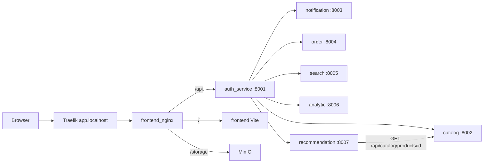
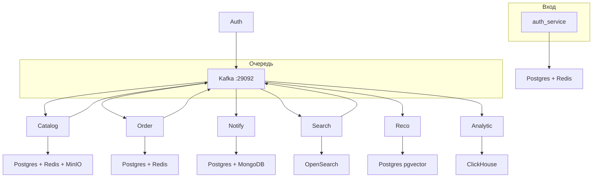

# Архитектура

Браузер ходит только на `https://app.localhost`. Traefik отдаёт трафик в `frontend_nginx`. Дальше `/api` уходит в `auth_service` (JWT и API gateway), страницы — во frontend, `/storage` — в MinIO.

Сервисы слушают порты только внутри сети `php_project_net`. С хоста их порты не публикуются.

## HTTP

JWT проверяет только auth. Для админского JSON каталога и Filament gateway подставляет `X-User-Id` и `X-User-Role`. Для заказов и чата рекомендаций подставляет `user_id` (у заказов ещё email и name) в query и body.

| Кто | Пути gateway |
|-----|----------------|
| без JWT | login, registration, refresh, Stripe webhook, search, recommendations health |
| любой пользователь | `/api/catalog`, `/api/orders`, `/api/recommendations` |
| admin и analyst | `/api/notifications`, `/api/admin/orders`, `/api/analytics` |
| admin | users/roles, catalog admin, upload, Filament `/admin-catalog`, recommendations reindex |

Прямой HTTP между сервисами один: recommendation → catalog `GET /api/catalog/products/{id}` для проверки, что карточка ещё опубликована. Поиск и индекс ассистента живут локально.

## Данные и брокер

У каждого сервиса своя база. Общей SQL-базы нет.

## Kafka

Тип события — header `event-type`.

| Топик | Кто пишет | Кто читает |
|-------|-----------|------------|
| `user.events` (`user.registered`) | auth, сразу | notification, analytic |
| `product.created`, `product.updated` | catalog, сразу | order, search, recommendation, analytic |
| `product.deleted` | catalog, сразу | search, recommendation |
| `product.published`, `product.unpublished` | catalog, сразу | recommendation |
| `category.*` | catalog, сразу | search |
| `stock.events` (`stock.reserved`, `stock.reservation_failed`) | catalog, outbox | order |
| `catalog.events` (`stock.changed`) | catalog, outbox | search, recommendation |
| `order.events` | order, outbox | catalog (`order.created`, `stock.release_requested`, `stock.commit_requested`), notification (`order.paid`, `order.confirmed`, `order.cancelled`), analytic (`order.created`, `order.paid`, `order.shipped`, `order.cancelled`) |
| `search.events` (`search.performed`) | search, сразу | analytic |
| `user.events.dlq`, `order.events.dlq` | notification | — |

`order.confirmed` читает только notification. `order.shipped` читает только analytic и пишет его как стадию `completed`.

События товара и категории catalog публикует сразу. Ответы saga по остаткам и lifecycle заказа идут через transactional outbox (`kafka:outbox:work`).

## Вне стека

| Система | Куда |
|---------|------|
| Stripe | webhook на gateway → order |
| Gemini | эмбеддинги и ответы ассистента в recommendation |
| Mailpit | исходящая почта notification |
