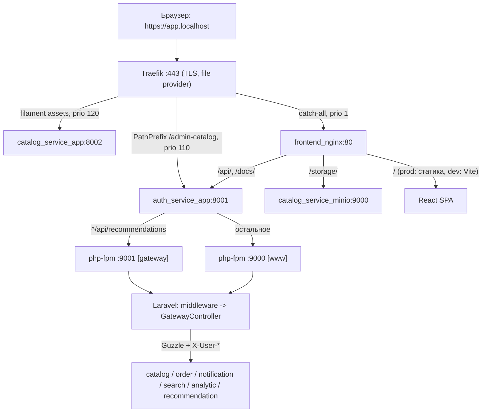
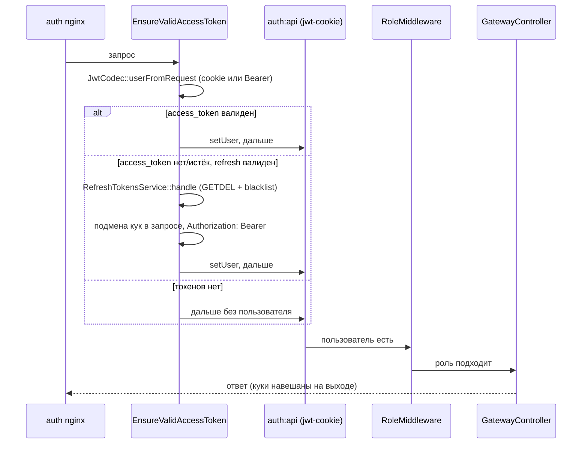

# Путь HTTP-запроса

Сквозной разбор: как запрос из браузера проходит Traefik, edge-nginx фронтенда, nginx внутри `auth_service` и Laravel-прокси, и какие заголовки при этом передаются в микросервисы.

Общая картина сервисов и Kafka — в [архитектуре](architecture.md). Здесь только HTTP-путь и проксирование.

## Обзор

Браузер открывает `https://app.localhost`. TLS терминирует Traefik, дальше почти весь трафик идёт в `frontend_nginx`, а он раскидывает `/api` в `auth_service`. Внутри auth запрос проходит middleware (JWT, роли) и уходит в нужный микросервис через Guzzle с заголовками identity.



Слои по порядку:

| # | Слой | Файл | Что делает |
|---|------|------|------------|
| 1 | Traefik | [`infra/traefik/dynamic.yml`](../infra/traefik/dynamic.yml) | TLS, роутинг по `Host`/`PathPrefix` |
| 2 | frontend nginx | [`frontend/nginx.conf`](../frontend/nginx.conf), [`frontend/nginx.prod.conf`](../frontend/nginx.prod.conf) | раздаёт SPA, проксирует `/api`, `/docs`, `/storage` |
| 3 | auth nginx | [`infra/php-base/nginx-laravel.conf.template`](../infra/php-base/nginx-laravel.conf.template) | front controller, выбор php-fpm пула |
| 4 | Laravel pipeline | [`auth_service/bootstrap/app.php`](../auth_service/bootstrap/app.php) | JWT, роли, маршрутизация |
| 5 | gateway-прокси | [`auth_service/app/Services/Gateway/`](../auth_service/app/Services/Gateway/) | выбор форвардера, инъекция `X-User-*`, вызов апстрима |

## Слой 1. Traefik

Traefik запускается из [`infra/compose.yml`](../infra/compose.yml) с **file provider** (`--providers.file.filename=/etc/traefik/dynamic.yml`), а не Docker provider: Docker provider ломается на Docker Engine API ≥ 1.40. Конфиг монтируется read-only, `--providers.file.watch=true` подхватывает правки без рестарта.

Точки входа: `web` (`:80`) и `websecure` (`:443`). Сертификаты — `infra/traefik/certs/app.localhost.pem` и `-key.pem` (не коммитятся, см. [инфраструктуру](infrastructure.md#tls-сертификаты)).

Роутеры (приоритет решает, кто выиграет при пересечении правил):

| Роутер | Правило | Сервис | Приоритет |
|--------|---------|--------|-----------|
| `catalog-filament-assets` | `PathPrefix(/css/filament)`, `/js/filament`, `/fonts/filament`, `PathRegexp(^/livewire-[a-f0-9]+)` | `catalog` → `catalog_service_app:8002` | 120 |
| `admin-catalog` | `PathPrefix(/admin-catalog)` | `auth` → `auth_service_app:8001` | 110 |
| `frontend` | `Host(app.localhost)` (catch-all) | `frontend` → `frontend_nginx:80` | 1 |
| `clickhouse-play` | `Host(clickhouse.localhost)` на `web` | `clickhouse` → `analytic_clickhouse:8123` | 10 |
| `http-redirect` | `Host(app.localhost)` на `web` | middleware `redirect-to-https` | 1 |

Важно: **Traefik не ходит напрямую в Laravel-сервисы**, кроме двух исключений — админ-панели Filament (`/admin-catalog` → auth, там HTML-прокси) и её статики (`/css/filament`, `/js/filament`, `/fonts/filament`, `/livewire-*` → catalog напрямую, без JWT). Всё остальное уходит в `frontend_nginx`.

## Слой 2. frontend nginx

Два варианта одного и того же конфига:

- **dev** — [`frontend/nginx.conf`](../frontend/nginx.conf): образ `nginx:1.28.0-alpine`, конфиг bind-mount'ится (`./nginx.conf:/etc/nginx/conf.d/default.conf:ro`), `location /` проксирует на Vite (`react_frontend:5173`).
- **prod** — [`frontend/nginx.prod.conf`](../frontend/nginx.prod.conf): запекается в образ `frontend:prod` ([`frontend/Dockerfile`](../frontend/Dockerfile), stage `prod`), `location /` отдаёт статику из `/usr/share/nginx/html` с SPA-fallback.

Prod-overlay [`compose.prod.yml`](../compose.prod.yml) подменяет образ и сбрасывает bind-mount (`volumes: !reset []`), а Vite-контейнер уходит в `profiles: ["dev"]`. Поэтому правка `nginx.prod.conf` требует **пересборки образа**, а не рестарта.

### Резолвинг апстримов

```nginx
resolver 127.0.0.11 valid=10s ipv6=off;
```

`127.0.0.11` — DNS Docker. Апстримы заданы через переменные (`set $auth_upstream http://auth_service_app:8001;`), потому что литерал в `proxy_pass` резолвится один раз при старте nginx и кешируется навсегда — после пересоздания контейнера (новый IP) проксирование сломалось бы. С переменной резолв идёт в рантайме, `valid=10s` — перерезолв раз в 10 секунд, `ipv6=off` — не дёргать AAAA.

### Распределение

| `location` | Апстрим | Особенности |
|------------|---------|-------------|
| `= /docs`, `= /docs/` | `auth_service_app:8001` | `rewrite ^ /docs/index.html break;` — у auth индекс `index.php`, сам `/docs/` не отдал бы `index.html` |
| `= /docs/openapi.yaml` | `auth_service_app:8001` | `proxy_hide_header Content-Type` + `add_header Content-Type "application/yaml"` |
| `/docs/` | `auth_service_app:8001` | остальные файлы Swagger UI как есть |
| `/api/` | `auth_service_app:8001` | главный маршрут API; `Cookie` вверх, `Set-Cookie` вниз |
| `/storage/` | `catalog_service_minio:9000` | `rewrite ^/storage/(.*)$ /$1 break;` (path-style), `Host localhost` (MinIO отвергает hostname с `_`), `proxy_buffering off` |
| `/` | prod: `try_files $uri $uri/ /index.html`; dev: `react_frontend:5173` | SPA-fallback / Vite с WebSocket-upgrade |

Во всех прокси-блоках прокидываются `Host $host`, `X-Real-IP $remote_addr`, `X-Forwarded-For $proxy_add_x_forwarded_for`, `X-Forwarded-Proto $scheme`.

Нюанс: **`$scheme` здесь всегда `http`**, потому что TLS уже снят на Traefik. `X-Forwarded-Proto: http` — ожидаемое поведение, а не баг (это же отмечено комментарием в конфиге).

## Слой 3. auth nginx

Внутри каждого Laravel-контейнера nginx и php-fpm живут рядом, оба стартуют из [`infra/php-base/entrypoint-http.sh`](../infra/php-base/entrypoint-http.sh) (`CMD http`). Шаблон [`nginx-laravel.conf.template`](../infra/php-base/nginx-laravel.conf.template) рендерится в `/etc/nginx/conf.d/laravel.conf` через `envsubst` с `NGINX_PORT` (у auth — `8001`).

Ключевые части:

```nginx
location / {
    try_files $uri $uri/ /index.php?$query_string;
}

include /etc/nginx/gateway/*.conf;

location ~ \.php$ {
    try_files $uri =404;
    fastcgi_pass 127.0.0.1:9000;
    ...
}
```

`include /etc/nginx/gateway/*.conf` стоит **до** общего `location ~ \.php$`, поэтому gateway-локация перехватывает свои пути раньше. Если `GATEWAY_FPM_PORT` не задан, каталог пуст и include — no-op.

### Два пула php-fpm

| Пул | Порт | Файл | Назначение |
|-----|------|------|------------|
| `[www]` | `9000` | [`zz-laravel-fpm.conf`](../infra/php-base/zz-laravel-fpm.conf) | обычные запросы: логин, refresh, CRUD |
| `[gateway]` | `9001` | [`zz-gateway-fpm.conf.template`](../infra/php-base/zz-gateway-fpm.conf.template) | долгие gateway-роуты |

`[gateway]` включается только при `GATEWAY_FPM_PORT ≠ 9000`. У auth в [`auth_service/compose.yml`](../auth_service/compose.yml):

```yaml
GATEWAY_FPM_PORT: 9001
GATEWAY_FPM_MAX_CHILDREN: 40
GATEWAY_ROUTES: "^/api/recommendations"
```

`render_gateway_pool()` генерирует `/etc/nginx/gateway/gateway.conf`:

```nginx
location ~ ^/api/recommendations {
    fastcgi_pass 127.0.0.1:9001;
    fastcgi_index index.php;
    include fastcgi_params;
    fastcgi_param SCRIPT_FILENAME $realpath_root/index.php;
    fastcgi_param SCRIPT_NAME /index.php;
    fastcgi_param DOCUMENT_ROOT $realpath_root;
    fastcgi_hide_header X-Powered-By;
}
```

`SCRIPT_FILENAME` жёстко указывает на `index.php`, потому что это Laravel-роут, а не файл на диске.

Зачем разделение: чат рекомендаций держит воркер до ~120 с. При одном пуле (`pm.max_children = 20`) два десятка параллельных чатов выедали бы всех воркеров и `/api/login`, `/api/registration`, `/api/refresh` вставали бы в очередь. Подробности и проверка — [ADR 0001](adr/0001-gateway-in-auth.md) и `./scripts/load-chat-login.sh`.

Таймауты согласованы по всей цепочке: `fastcgi_read_timeout 300s` в nginx, `request_terminate_timeout = 300s` и `max_execution_time = 300` в пуле `[gateway]`, `ProxyOptions(timeout: 120)` в PHP.

## Слой 4. Laravel pipeline

Порядок middleware задан в [`auth_service/bootstrap/app.php`](../auth_service/bootstrap/app.php). `EnsureValidAccessToken` добавлен в priority list **перед** контрактом `AuthenticatesRequests` — без этого `auth:api` отработал бы раньше и тихий refresh никогда бы не выполнялся.



### `ensure.token` — [`EnsureValidAccessToken`](../auth_service/app/Http/Middleware/EnsureValidAccessToken.php)

1. `JwtCodec::userFromRequest()` — берёт `access_token` из cookie или `Authorization: Bearer`, декодирует JWT, проверяет `jti` в Redis-blacklist, достаёт `User` по `sub`.
2. Если пользователя нет — берёт `refresh_token` и вызывает [`RefreshTokensService::handle()`](../auth_service/app/Services/Auth/RefreshTokensService.php): проверка blacklist по хэшу, атомарный `GETDEL` старого refresh (только первый конкурентный вызов получит `user_id`), blacklist старого хэша, выпуск новой пары.
3. Новые токены подставляются в куки запроса и `Authorization`, пользователь ставится в guard `api`.
4. На выходе [`TokenCookies::attach()`](../auth_service/app/Services/Auth/TokenCookies.php) вешает `access_token`/`refresh_token` (HttpOnly, path `/`, `SameSite=Lax`).

### `auth:api`

Guard `jwt-cookie` зарегистрирован в [`AppServiceProvider`](../auth_service/app/Providers/AppServiceProvider.php) и повторно резолвит пользователя из cookie/Bearer. Нет пользователя — 401 JSON (обработчик в `bootstrap/app.php`).

### `role:*` — [`RoleMiddleware`](../auth_service/app/Http/Middleware/RoleMiddleware.php)

Роль берётся из `$user->role->slug`. `analyst` строго read-only: любой не-`GET` отклоняется с 403 на периметре, независимо от verb'а маршрута.

### Маршруты

[`routes/api.php`](../auth_service/routes/api.php) и [`routes/web.php`](../auth_service/routes/web.php):

| Кто | Пути |
|-----|------|
| без JWT | `POST /api/login`, `/api/registration`, `/api/refresh`, `/api/webhooks/stripe`, `GET /api/search`, `/api/search/autocomplete`, `/api/recommendations/health`, `/api/catalog/*` (storefront) |
| любой пользователь | `/api/user`, `/api/logout`, `/api/profile*`, `/api/orders/*`, `/api/recommendations/*` |
| admin и analyst | `/api/notifications/*`, `/api/admin/orders/*`, `/api/analytics/*` |
| admin | `/api/admin/*` (catalog admin + users/roles), `/api/get-upload-url`, `/api/recommendations/reindex`, `/admin-catalog/*` (Filament) |

Rate limits объявлены в [`AppServiceProvider`](../auth_service/app/Providers/AppServiceProvider.php): `login` — 5/мин по Email+IP, `search` — 60/мин по IP; `registration` — 5/мин, `refresh` — 30/мин (в маршрутах).

## Слой 5. Проксирование

Каждый метод [`GatewayController`](../auth_service/app/Http/Controllers/Gateway/GatewayController.php) — тонкая обёртка над `forwardService()`:

```php
private function forwardService(
    Request $request,
    string $service,
    string $pathKey,
    string $path = '',
    ProxyOptions $options = new ProxyOptions,
): Response {
    $baseUrl = (string) config("services.{$service}.url");
    $prefix = (string) config("services.{$service}.paths.{$pathKey}");

    return $this->forwarder->forward(
        $request,
        $baseUrl,
        $this->forwarder->joinPath($prefix, $path),
        $options,
    );
}
```

URL = хост сервиса + префикс по `pathKey` + хвост пути. Хосты и префиксы — в [`config/services.php`](../auth_service/config/services.php):

| Сервис | Хост (ENV) | Префиксы |
|--------|------------|----------|
| catalog | `CATALOG_SERVICE_URL` → `catalog_service_app:8002` | `/api/catalog`, `/api/admin`, `/admin-catalog`, `/api/get-upload-url` |
| notification | `NOTIFICATION_SERVICE_URL` → `notification_service_app:8003` | `/api/notifications` |
| order | `ORDER_SERVICE_URL` → `order_service_app:8004` | `/api/orders`, `/api/admin/orders`, `/api/webhooks/stripe` |
| search | `SEARCH_SERVICE_URL` → `search_service_app:8005` | `/api/search`, `/api/search/autocomplete` |
| analytic | `ANALYTIC_SERVICE_URL` → `analytic_service_api:8006` | `/analytics` |
| recommendation | `RECOMMENDATION_SERVICE_URL` → `recommendation_service_app:8007` | `/api/recommendations`, `/api/recommendations/health`, `/api/recommendations/reindex` |

[`ForwardRequestService::forward()`](../auth_service/app/Services/Gateway/ForwardRequestService.php) выбирает форвардер по `ProxyOptions::$mode` ([`ProxyMode`](../auth_service/app/Enums/ProxyMode.php)):

| `ProxyMode` | Форвардер | Где используется |
|-------------|-----------|------------------|
| `Json` (по умолчанию) | [`JsonForwarder`](../auth_service/app/Services/Gateway/Forwarders/JsonForwarder.php) | orders, notifications, admin catalog, analytics, recommendations |
| `Html` | [`HtmlForwarder`](../auth_service/app/Services/Gateway/Forwarders/HtmlForwarder.php) | Filament `/admin-catalog` |
| `Raw` | [`RawForwarder`](../auth_service/app/Services/Gateway/Forwarders/RawForwarder.php) | Stripe webhook |

[`ProxyOptions`](../auth_service/app/DTO/Gateway/ProxyOptions.php) несёт три вещи: `mode`, `identity` (nullable [`GatewayIdentity`](../auth_service/app/DTO/Auth/GatewayIdentity.php)) и `timeout`. Таймаут по умолчанию 30 с, у рекомендаций — 120 с (`GatewayController::RECOMMENDATION_TIMEOUT`).

## Форвардеры и заголовки

### JsonForwarder

1. Метод нормализуется в верхний регистр: Guzzle 8 шлёт verb как есть, а nginx отвечает 400 на lowercase.
2. Заголовки: `Accept: application/json` + `X-Forwarded-For` (`$request->ip()`) + `X-Forwarded-Proto` + whitelist `Content-Type`, `Idempotency-Key` + identity.
3. `Cookie` **не копируется** вообще.
4. Тело: для `GET`/`DELETE`/`HEAD` — `query`, иначе `json => $request->all()`.
5. `Http::withHeaders(...)->timeout(...)->send($method, $url, $payload)`.

### HtmlForwarder

- Прокидывает `Host`, `X-Forwarded-Host`, `X-Forwarded-Port`, `X-Forwarded-For`, `X-Forwarded-Proto`, identity.
- Whitelist запроса: `Accept`, `Accept-Language`, `Content-Type`, `X-Livewire`, `X-CSRF-TOKEN`, `X-XSRF-TOKEN`, `Referer`, `Origin`.
- `Cookie` фильтруется: `access_token` и `refresh_token` вырезаются (`stripAuthCookies`) — catalog нужны только его собственные session/XSRF-куки.
- Multipart: после парсинга `$_FILES` в `php://input` пусто, поэтому тело пересобирается из `UploadedFile` (рекурсивно, с сохранением имён полей).
- `allow_redirects => false` — редиректы Filament отдаются клиенту как есть.

### RawForwarder

- Только `Content-Type` и `Stripe-Signature`; тело передаётся байт-в-байт (`withBody($request->getContent(), ...)`), чтобы проверка подписи Stripe прошла.
- Identity не добавляется.

### Сводная таблица заголовков

| Заголовок | Json | Html | Raw |
|-----------|------|------|-----|
| `X-User-Id` | да (если identity) | да | нет |
| `X-User-Role` | да (если identity) | да | нет |
| `X-User-Name` / `X-User-Email` | да, если непустые | да, если непустые | нет |
| `X-Forwarded-For` | да | да | да |
| `X-Forwarded-Proto` | да | да | да |
| `Host` / `X-Forwarded-Host` / `X-Forwarded-Port` | нет | да | нет |
| `Content-Type` | да | да | да |
| `Idempotency-Key` | да | нет | нет |
| `Stripe-Signature` | нет | нет | да |
| `X-Livewire`, CSRF, `Referer`, `Origin` | нет | да | нет |
| `Cookie` | нет | да, без JWT-кук | нет |
| Клиентские `X-User-*` | нет (перезаписываются) | нет | нет |

## Инъекция identity

[`GatewayIdentity::toHeaders()`](../auth_service/app/DTO/Auth/GatewayIdentity.php) — единственный источник `X-User-*`:

```php
$headers = [
    'X-User-Id' => (string) $this->id,
    'X-User-Role' => $this->role,
];

if ($this->name !== '') {
    $headers['X-User-Name'] = $this->name;
}

if ($this->email !== '') {
    $headers['X-User-Email'] = $this->email;
}
```

Identity передаётся только там, где контроллер её явно запросил (`new ProxyOptions(identity: $this->gatewayIdentity($request))`): orders, admin orders, admin catalog, upload, notifications, recommendations. Публичные маршруты (storefront catalog, search, recommendations health, analytics, Stripe webhook) идут без неё.

`user_id` **не** дублируется в body/query — только заголовок. Клиентские `X-User-*` не пересылаются: identity перезаписывает их.

Приёмная сторона (defense-in-depth, [ADR 0005](adr/0005-trust-gateway-headers.md)):

| Сервис | Middleware | Что проверяет |
|--------|------------|---------------|
| order | [`ResolveGatewayIdentity`](../order_service/app/Http/Middleware/ResolveGatewayIdentity.php), [`DenyAnalystWrites`](../order_service/app/Http/Middleware/DenyAnalystWrites.php) | `X-User-Id`/`X-User-Email`/`X-User-Name` → `user_id`/`email`/`name`; `analyst` read-only |
| recommendation | [`ResolveGatewayUserId`](../recommendation_service/app/Http/Middleware/ResolveGatewayUserId.php), [`EnsureGatewayRole`](../recommendation_service/app/Http/Middleware/EnsureGatewayRole.php) | `X-User-Id`; роль ∈ admin/analyst/customer |
| catalog (admin) | [`AuthenticateFromGatewayHeaders`](../catalog_service/app/Http/Middleware/AuthenticateFromGatewayHeaders.php) | `X-User-Id` numeric ≥ 1 **и** `X-User-Role: admin` |
| notification | [`RequireGatewayRole`](../notification_service/app/Http/Middleware/RequireGatewayRole.php) | роль ∈ admin/analyst, analyst read-only |
| analytic (Go) | `requireRole` в [`handlers.go`](../analytic_service/internal/httpapi/handlers.go) | `X-User-Role` ∈ admin/analyst |

## Обратный путь

- **Json / Raw** — [`UpstreamHeaders::jsonResponse()`](../auth_service/app/Services/Gateway/UpstreamHeaders.php): тело и статус апстрима как есть, `Content-Type` копируется при наличии. `Set-Cookie` апстрима не пробрасываются.
- **Html** — [`HtmlForwarder::response()`](../auth_service/app/Services/Gateway/Forwarders/HtmlForwarder.php): whitelist `Content-Type`, `Content-Disposition`, `Cache-Control`, `Pragma`, `Expires`, `Location` + **все** `Set-Cookie` апстрима (нужна сессия Filament).
- **Куки auth** навешиваются middleware (`TokenCookies::attach`) уже после ответа апстрима.
- **Logout панели** — особый случай в `GatewayController::catalogAdminPanel()`: после успешного `POST /admin-catalog/logout` вызывается `LogoutUserService` (ревокация JWT) и `TokenCookies::clear()`, чтобы панель нельзя было переоткрыть теми же куками.

## Сводка параметров

| Параметр | Значение | Где |
|----------|----------|-----|
| TLS | `:443`, сертификаты `infra/traefik/certs/` | [`infra/traefik/dynamic.yml`](../infra/traefik/dynamic.yml) |
| `client_max_body_size` | 32m | оба nginx |
| `fastcgi_read_timeout` | 300s | [`nginx-laravel.conf.template`](../infra/php-base/nginx-laravel.conf.template) |
| `[www]` `pm.max_children` | 20 | [`zz-laravel-fpm.conf`](../infra/php-base/zz-laravel-fpm.conf) |
| `[gateway]` `pm.max_children` | 40 (`GATEWAY_FPM_MAX_CHILDREN`) | [`zz-gateway-fpm.conf.template`](../infra/php-base/zz-gateway-fpm.conf.template) |
| `[gateway]` `request_terminate_timeout` | 300s | там же |
| Proxy timeout (по умолчанию) | 30s | [`ProxyOptions`](../auth_service/app/DTO/Gateway/ProxyOptions.php) |
| Proxy timeout (recommendations) | 120s | [`GatewayController`](../auth_service/app/Http/Controllers/Gateway/GatewayController.php) |
| Rate limit login | 5/мин, Email+IP | [`AppServiceProvider`](../auth_service/app/Providers/AppServiceProvider.php) |
| Rate limit search | 60/мин, IP | там же |
| Rate limit registration | 5/мин | [`routes/api.php`](../auth_service/routes/api.php) |
| Rate limit refresh | 30/мин | там же |
