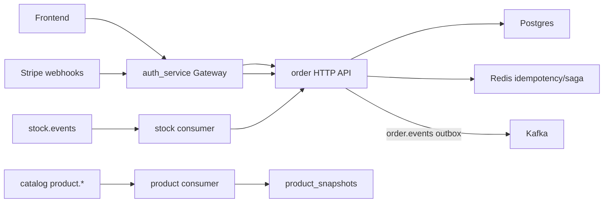
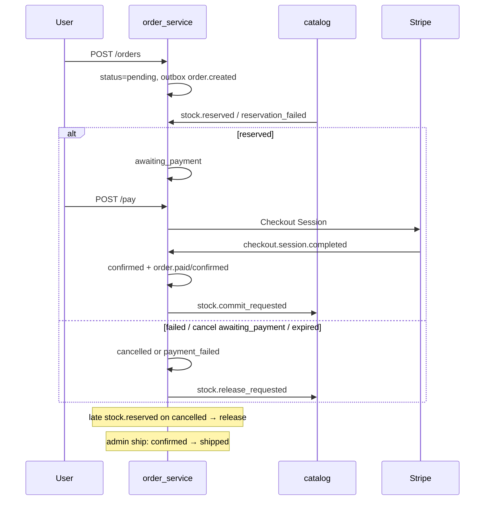

# Order service

Laravel-микросервис **заказов и оплаты**: создаёт заказы из product snapshots, оркестрирует saga (reserve stock → Stripe Checkout → confirm/cancel/ship) и публикует lifecycle-события в Kafka через transactional outbox.

---

## Общая архитектура

Ключевые файлы:

- Create/cancel/ship: [`app/Services/Order/`](app/Services/Order/)
- Checkout/webhooks: [`app/Services/Payment/`](app/Services/Payment/)
- Outbox: [`app/Services/OutboxWriter.php`](app/Services/OutboxWriter.php)
- Routes: [`routes/api.php`](routes/api.php)
- Workers: `kafka:consume:product-events`, `kafka:consume:stock-events`, `ecotone:run kafka-outbox`, `ecotone:run inbox` ([`compose.yml`](compose.yml))

---

## Trust model (auth)

**JWT и роли проверяет только `auth_service` gateway.** Order service не валидирует токены и не является вторым IdP.

1. Customer: `ANY /api/orders/...` на gateway → proxy на order; gateway **перезаписывает** `user_id` / `email` / `name` в query и body из JWT ([`ProxyService::mergeInjectedUser`](../auth_service/app/Services/Gateway/ProxyService.php)).
2. Admin: middleware `role:admin,analyst` на gateway → `/api/admin/orders/...` (ship сейчас доступен analyst на периметре gateway).
3. Stripe webhook: raw proxy; auth = проверка `Stripe-Signature` внутри order service.
4. Сервис слушает `:8004` только во внутренней Docker-сети (`expose`); публичный вход — через gateway. Прямой вызов с mesh без gateway — assumption периметра.

---

## Domain model

| Entity | Роль |
|--------|------|
| `Order` | saga_id, user_id, contact, status, total_amount |
| `OrderItem` | product_id → snapshot, quantity, unit_price |
| `Payment` | amount, status, stripe session / payment_intent |
| `ProductSnapshot` | локальный кэш каталога (цена/store/category) |
| `OutboxEvent` | topic + event_type + payload до публикации в Kafka |

**Статусы** (`OrderStatus`):

`pending` → `awaiting_payment` → `confirmed` → `shipped`  
ветви: `cancelled`, `payment_failed`

Переходы инкапсулированы в модели `Order` (не разрозненные строки в сервисах).

---

## HTTP API

Префикс Laravel `/api`. CSRF exemption для `api/*`.

| Method | Path | Назначение |
|--------|------|------------|
| GET | `/orders` | Список заказов пользователя (`user_id` от gateway) |
| POST | `/orders` | Создать заказ; **обязателен** `Idempotency-Key` |
| GET | `/orders/{id}` | Карточка заказа (scoped по user_id) |
| POST | `/orders/{id}/cancel` | Отмена + stock release при `awaiting_payment` |
| POST | `/orders/{id}/pay` | Stripe Checkout; **обязателен** `Idempotency-Key` |
| GET | `/admin/orders` | Все заказы |
| GET | `/admin/orders/{id}` | Карточка |
| POST | `/admin/orders/{id}/ship` | Только из `confirmed` |
| POST | `/webhooks/stripe` | Stripe events |

Цены на create берутся из `ProductSnapshot`, не из тела запроса.

---

## Saga

Сток:

- успех оплаты → `stock.commit_requested` (`quantity-=`, `reserved-=` на catalog);
- cancel при `awaiting_payment` / Stripe `checkout.session.expired` → `stock.release_requested` (`reserved-=`);
- cancel из `pending` release **не** шлёт; если позже придёт `stock.reserved` на уже `cancelled`/`payment_failed` — order запросит release (late-reserve compensation).

---

## Kafka и outbox

**Consume**

| Topics | Handler |
|--------|---------|
| `product.created`, `product.updated` | upsert `ProductSnapshot` |
| `stock.events` (`stock.reserved`, `stock.reservation_failed`) | статус заказа; `saga_id` должен совпасть с `order.saga_id` |

**Produce** (topic `order.events` через outbox):  
`order.created`, `order.cancelled`, `order.paid`, `order.confirmed`, `order.shipped`, `stock.release_requested`, `stock.commit_requested`.

Паттерн: domain event в той же DB TX → `OutboxPublisher` пишет канал `kafka-outbox` → `ecotone:run kafka-outbox` публикует в Kafka.

---

## Stripe

- `POST /pay` создаёт (или переиспользует open) Checkout Session; сумма из order items.
- Webhook `checkout.session.completed`: только при `payment_status=paid`, совпадении amount, статусе заказа `awaiting_payment` → confirm + `stock.commit_requested`.
- `checkout.session.expired` → `payment_failed` + stock release (без изменений).
- Cancel при `awaiting_payment` expire’ит open sessions и запрашивает stock release.

---

## Idempotency и SagaStepGuard

**Redis IdempotencyStore** (scoped):

- create: `order:idempotency:create:{userId}:{key}`
- pay: `order:idempotency:pay:{userId}:{orderId}:{key}`

Паттерн: get cached → acquire lock → work → put response → release. Ключ клиента ограничен по длине; create/pay требуют заголовок `Idempotency-Key`.

**SagaStepGuard** + **SagaStepRunner** (Redis): `tryBegin` / `put` / `release`; `busy` → exception (retry). Шаги: `order.created`, `stock.reserved`, `stock.reservation_failed`, `stock.release_requested`, `stock.commit_requested`.

---

## Зависимости

| Сервис | Связь |
|--------|--------|
| auth_service | JWT perimeter, inject identity, proxy webhook |
| catalog_service | product snapshots in; reserve/release via Kafka |
| notification_service | consumes `order.events` |
| Stripe / Redis / Postgres / Kafka | платежи, locks, данные, события |

---

## Карта классов

| Path | Role |
|------|------|
| `app/Domain/OrderStatus.php` | enum статусов |
| `app/Domain/Money.php` | денежная арифметика (bcmath) |
| `app/Services/Order/*` | create/query/cancel/ship/payloads/stock release |
| `app/Services/Payment/*` | checkout + webhook confirm/fail |
| `app/Contracts/*` | IdempotencyStore, SagaStepStore, PaymentGateway, Outboxable |
| `app/Kafka/Handlers/*` | product/stock consumers |
| `app/Console/Commands/Kafka*.php` | workers |
