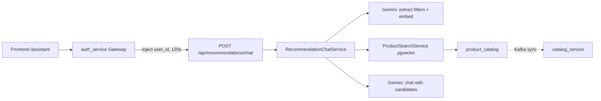
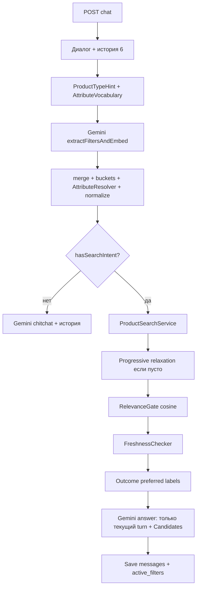
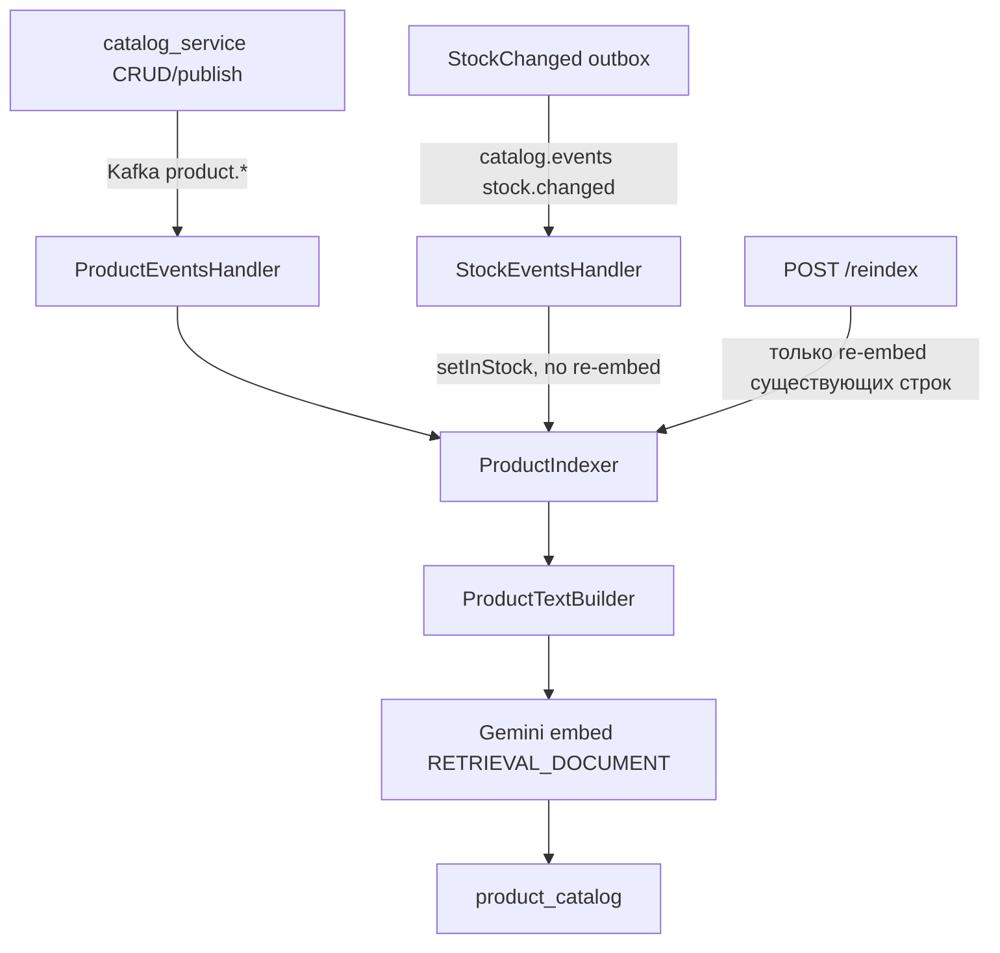

# Recommendation service

Laravel-микросервис **shopping recommendation assistant**: RAG поверх локальной копии каталога в Postgres+pgvector, оркестрация на PHP, LLM — Google Gemini. Function calling / tools у модели **нет** — поиск делает бэкенд, модель только извлекает фильтры и пишет ответ по готовым кандидатам.

---

## Общая архитектура



Ключевые файлы:

- Оркестрация: [`app/Services/Chat/RecommendationChatService.php`](app/Services/Chat/RecommendationChatService.php)
- Поиск: [`app/Services/Catalog/ProductSearchService.php`](app/Services/Catalog/ProductSearchService.php)
- LLM: [`app/Services/Llm/Gemini/GeminiLlmClient.php`](app/Services/Llm/Gemini/GeminiLlmClient.php)
- Карточки/path: [`app/Models/ProductCatalog.php`](app/Models/ProductCatalog.php) → `toCardArray()`
- UI: [`../frontend/src/Pages/Assistant.jsx`](../frontend/src/Pages/Assistant.jsx)

---

## 1. Цепочка HTTP-запроса (от клика до ответа)

### Frontend

1. Пользователь на `/assistant` ([`../frontend/src/App.jsx`](../frontend/src/App.jsx), auth required).
2. [`Assistant.jsx`](../frontend/src/Pages/Assistant.jsx) шлёт:
   - `POST /api/recommendations/chat` — `{ message, conversation_id? }`
   - `GET /api/recommendations/conversations/{id}` — восстановление истории
   - `DELETE /api/recommendations/conversations/{id}` — новый диалог
3. `conversation_id` хранится в `sessionStorage` (`assistant_conversation_id`).
4. Браузер **не** передаёт `user_id` — его подставляет gateway.

### Gateway (`auth_service`)

- JWT middleware → `GatewayController::recommendations`
- Прокси на `{RECOMMENDATION_SERVICE_URL}/api/recommendations/...`
- `ProxyService` вшивает `user_id` в body/query
- Таймаут чата **120s** (LLM медленный)

### Recommendation API

Маршруты в [`routes/api.php`](routes/api.php) (префикс Laravel `/api`):

| Метод | Путь | Контроллер |
|-------|------|------------|
| POST | `/recommendations/chat` | `ChatController` |
| GET/DELETE | `/recommendations/conversations/{id}` | `ConversationController` |
| POST | `/recommendations/reindex` | `ReindexController` (admin через gateway) |
| GET | `/recommendations/health` | `HealthController` |

`ChatController` валидирует через `ChatRequest` и вызывает `RecommendationChatService::chat()`.

### Ответ клиенту

```json
{
  "conversation_id": "uuid",
  "answer": "текстовый ответ ассистента",
  "extracted_filters": { "store_id": null, "store_name": null, "category_name": null, "query": "...", "attributes": [] },
  "products": [ { "product_id": 42, "name": "...", "path": "/products/42", ... } ]
}
```

---

## 2. Как работает ИИ по шагам (полный пайплайн)

Модель **не ищет** товары сама. PHP ищет в локальном `product_catalog`; Gemini только (1) извлекает фильтры + embedding и (2) пишет текст по готовому списку Candidates.

Оркестрация: [`RecommendationChatService::chat()`](app/Services/Chat/RecommendationChatService.php). Общий budget Gemini на turn: `GEMINI_TIMEOUT` (~25s) на extract + embed + answer.



### 2.1. Диалог и история

1. Нет `conversation_id` → новый `Conversation` (`expires_at = min(hard 24h, idle 30m)`).
2. Есть id → только свой и `expires_at > now()`, иначе 404 (UI сбрасывает id и ретраит).
3. История: последние **6** сообщений (`HISTORY_LIMIT`).
4. Sticky: `conversations.active_filters` с прошлого хода.

История для **extract** ≠ история для **answer**:
- extract: sticky JSON + **только user turns** + текущее сообщение;
- product-search answer: **только** текущий turn + Candidates (без прошлых «не нашлось»);
- chitchat: короткая история остаётся.

### 2.2. Product-type hint и scoped vocabulary (до extract)

Чтобы в extract не попадал глобальный top-N attrs (джинсы `Размер` + телефоны `Экран`).

[`ProductTypeHint`](app/Services/Catalog/ProductTypeHint.php) (приоритет):

1. Keywords текущего сообщения (`телефон` → smartphones, …) — **перекрывают** sticky.
2. Client `category_name` (если придёт с UI).
3. Sticky `category_name` / `query`.
4. Нет hint → пустой список в промпте (не глобальный dump).

[`AttributeVocabulary::namesForScope`](app/Services/Catalog/AttributeVocabulary.php): SQL по published + `category_name ILIKE`, частоты имён, Cache (file/db, без Redis), cap ~30 → в extract system: *prefer these exact names*. Invalidate в `ProductIndexer`. Конфиг: [`config/attributes.php`](config/attributes.php).

### 2.3. Gemini #1: extract + embed

`extractFiltersAndEmbed` → `SearchFilters` + вектор `RETRIEVAL_QUERY`.

LLM возвращает: `query`, store/category, prices, `attributes[{name,value}]` (плоский список **без** required/preferred). Embed по `filters.query`, иначе raw message.

Модель здесь не видит каталог товаров — только текст и scoped имена attrs.

### 2.4. Merge, бакеты attrs, resolver, normalize

#### Бакеты: soft / preferred / required

LLM не назначает бакеты. Это делает PHP — [`AttributeConstraintDetector::split`](app/Services/Catalog/AttributeConstraintDetector.php) — после extract, в `mergeFilters`.

Для каждого attr (после `canonicalize` имени):

```
пустое name/value → выкинуть
          │
          ▼
exclusive?  ИЛИ  это размер?  ──да──► required
          │
         нет
          ▼
цвет / бренд / материал?  ──да──► preferred
          │
         нет
          ▼
        soft
```

| Bucket | Условие | Поведение в поиске |
|--------|---------|-------------------|
| **required** | exclusive-слова **или** attr = размер (`size_range`) | hard: товар обязан матчить |
| **preferred** | Цвет / Бренд / Материал (whitelist после canonicalize) | сначала hard, если пусто → soft fallback |
| **soft** | всё остальное (Экран, Память, …) | только re-rank / boost |

**Exclusive** (`только|исключительно|именно|строго|ровно|точно` как целое слово, ё→е):

- в **текущем** сообщении → все attrs из extract → required;
- или в любом **user**-turn истории → то же на follow-up (sticky exclusive).

**Размер** → всегда required (через synonym group `size` → strategy `size_range` в config), даже без exclusive.

**Preferred whitelist** в коде: `цвет`, `бренд`, `материал` (aliases: color→Цвет, brand/марка→Бренд, …).

Приоритет: exclusive/size **бьёт** preferred («только синие» → Цвет в required, не preferred).

На бакеты влияет текст пользователя так:

1. какие attrs вытащил LLM из формулировки;
2. есть ли exclusive-слова сейчас или в истории;
3. имя attr (размер / цвет / …) после canonicalize.

#### AttributeResolver (scoped vocab)

[`AttributeResolver`](app/Services/Catalog/AttributeResolver.php): exact / synonym (`диагональ`↔`Экран`) / fuzzy ≥80%. Не резолвится при непустом vocab → `value_only` soft. Unresolved `value_only` из required/preferred **спускается в soft**.

#### Client overrides + normalize

- Client `store_id` побеждает, extracted `store_name` обнуляется (и наоборот).
- `query` **не** подменяется на raw message (null = chitchat).
- [`SearchFiltersNormalizer`](app/Services/Catalog/SearchFiltersNormalizer.php): trim, swap inverted prices, default `in_stock=true`.

#### Intent gate

`hasSearchIntent()` = есть `query` или любой фильтр/attrs (кроме «голого» default in_stock).

- Нет → chitchat Gemini, `products = []`, поиск не вызывается.
- Есть → поиск.

### 2.5. Поиск в `product_catalog`

Локальный индекс (Kafka), не live catalog на каждый hit (кроме freshness в конце).

**Preferred soft-fallback** ([`ProductSearchService`](app/Services/Catalog/ProductSearchService.php)):

1. Hard attempt: required ∪ preferred как hard.
2. Хиты есть → `preferredRelaxed = false`.
3. Пусто → preferred в soft, required остаются → `preferredRelaxed = true`.

**`searchWithHardAndSoft`:**

1. SQL base: `is_published`, embedding not null; опционально store/category (ILIKE+ё→е), `in_stock`, price.
2. Vector top-K (cosine): soft → pool до **80**, hard → до **200**.
3. ≥2 soft attrs → доп. attribute-first fallback + merge.
4. Hard attrs: PHP должен матчить **все** required; если 0 → fallback pool **500** + SQL prefilter + снова hard PHP.
5. Soft re-rank по числу совпавших attrs, затем distance; slice до `limit`.

**Match значений** — [`AttributeValueMatcher`](app/Services/Catalog/AttributeValueMatcher.php): strategies `numeric` / `text` / `size_range` из config (`value_match`); слова/единицы только в config.

### 2.6. Progressive relaxation (если поиск пустой)

До **3** шагов. [`SearchFiltersRelaxer`](app/Services/Catalog/SearchFiltersRelaxer.php) снимает по одному: Материал → Бренд → Цвет (preferred, иначе required) → `store_name` → price. После каждого — повторный поиск. Label → `relaxedLabels`.

### 2.7. Отбрасывание после поиска

| Этап | Что отсекает |
|------|----------------|
| SQL base | unpublished, no embedding, store/category/stock/price |
| Hard attrs | PHP: не все required совпали |
| Preferred hard miss | не отбрасывает выдачу — soft path |
| Soft attrs | не отбрасывают; только поднимают в рейтинге |
| RelevanceGate | `distance > max_cosine_distance` (default **0.75**) |
| FreshnessChecker | удалён / unpublished в live catalog; transport fail → fail-open |
| Answer LLM | не фильтрует список |

### 2.8. «Ослабленные условия» (копирайт для LLM)

Не по флагу soft-path, а по **исходу**: preferred soft-path + финальный hit **не** матчит attr → label `Цвет=… (точный Цвет не обязателен)`. Если hit матчит цвет — label не пишем. Плюс labels progressive relaxer.

### 2.9. Gemini #2: ответ

User content = сообщение + `Candidates:` (+ `Ослабленные условия`). Вызов **без** истории. System: рекомендовать только текущие Candidates; при непустом списке нельзя писать «не найдено»; не упоминать прошлые запросы.

### 2.10. Сохранение

User + assistant messages, `active_filters` (+ `relaxed`), `touchActivity()`. JSON: `answer`, `extracted_filters`, `products` (карточки с `path`).

---

## 3. Как работает поиск (индекс и SQL)

### Локальный индекс `product_catalog`

Не live-запрос в catalog_service. Своя таблица с денормализованными полями + `embedding vector(768)`.

Фильтры в SQL ([`ProductSearchService`](app/Services/Catalog/ProductSearchService.php)):

- всегда: `is_published = true`, `embedding IS NOT NULL`
- опционально: `store_id` и/или `store_name` / `category_name` (ILIKE, case-insensitive, ё→е), `in_stock`, `price` min/max
- attributes: soft re-rank / preferred (semi-hard) / required (hard); SQL JSON prefilter на hard/fallback и при ≥2 soft attrs
- match имён: exact / `AttributeResolver` (синонимы `диагональ↔Экран` в scope) / fuzzy; `value_only` — soft match только по значению
- match значений: [`AttributeValueMatcher`](app/Services/Catalog/AttributeValueMatcher.php) — стратегии `numeric` / `text` / `size_range` из `config/attributes.php` (`value_match`); единицы и stems только в config
- сортировка: cosine distance `embedding <=> ?::vector`, затем boost по числу совпавших attributes

Семантический матчинг attrs (hint → vocab → resolver → value strategies) — см. §2.2–2.5.

### Откуда берутся товары (индексация)



- Consumers: `kafka:consume:product-events`, `kafka:consume:stock-events`
- Текст для эмбеддинга ([`ProductTextBuilder`](app/Services/Catalog/ProductTextBuilder.php)): `store`, `name`, `description`, `category`, attributes (без ID и флагов stock/publish)
- Stock меняет только `in_stock` без пересчёта вектора
- `reindex` **не тянет** каталог извне — только переэмбеддит то, что уже есть; наполнение — через Kafka / `RepublishProductsSeeder` в catalog
- Поле `store_name` заполняется из Kafka (`store.name`); после миграции нужен republish существующих товаров

---

## 4. Как ИИ «даёт ссылки» и куда реально кликают

Здесь два канала — важно не путать.

### A. Структурированные карточки (основной UX перехода)

`ProductCatalog::toCardArray()` жёстко ставит:

```php
'path' => '/products/'.$this->product_id,
```

Массив `products` уходит в JSON ответа.

Фронт в [`Assistant.jsx`](../frontend/src/Pages/Assistant.jsx) рендерит кликабельные карточки:

```jsx
<Link to={`/products/${product.product_id}`}>
```

Навигация идёт по `product_id` в SPA-роут `/products/:id` → `ProductPage` грузит товар из catalog API. Поле `path` с бэка совпадает с этим маршрутом, но UI его напрямую не читает.

Карточки сохраняются в `messages.products` (jsonb) вместе с ответом ассистента и возвращаются в `GET /conversations/{id}`, поэтому переживают reload и возврат со страницы товара.

### B. Текст ответа без сырых path

Кандидаты в промпт идут без `/products/...` (имя, цена, магазин). System prompt просит не писать path — переход по товарам только через карточки в UI.

---

## 5. LLM-слой (три режима Gemini)

Контракт [`LlmClient`](app/Services/Llm/Contracts/LlmClient.php), биндинг в `AppServiceProvider` при `LLM_DRIVER=gemini`.

| Метод | API | Назначение |
|-------|-----|------------|
| `embed` | `embedContent` | Векторы; `RETRIEVAL_QUERY` (чат) / `RETRIEVAL_DOCUMENT` (индекс); dim 768 |
| `extractFilters` | `generateContent` + `responseMimeType: application/json` | Фильтры поиска |
| `chat` | `generateContent` | Текстовый ответ ассистента |

Filter system prompt извлекает: `store_id` (только если пользователь явно назвал число), `store_name`, `category_name`, `in_stock`, `price_min/max`, `query` (тип товара без цвета), `attributes[]` (русские имена: Цвет, Размер, …).

Конфиг: [`config/llm.php`](config/llm.php) — `GEMINI_API_KEY`, `GEMINI_CHAT_MODEL` (default `gemini-3.8-flash`), `GEMINI_EMBEDDING_MODEL` (`gemini-embedding-001`), temperature `0.3`.

---

## 6. Диалоги и TTL

- Таблицы: `conversations` (uuid, user_id, last_activity_at, expires_at, active_filters), `messages` (role user|assistant, content, products jsonb, cascade delete)
- Hard TTL **24h** от создания, idle **30m** от активности → `expires_at = min(hard, idle)`
- API gate: `expires_at > now()` (для пользователя диалог уже протух)
- Cleanup: `conversations:cleanup` каждую минуту с `withoutOverlapping` (`routes/console.php` / `recommendation_scheduler`)
- Grace period **5 мин** (`Conversation::CLEANUP_GRACE_MINUTES`): физическое удаление только при `expires_at <= now() - 5m`, чтобы in-flight LLM-запрос не ловил FK после удаления
- Доступ только владельцу и только к не истёкшим; expired `conversation_id` → 404 (не auto-create)

---

## 7. Что важно понимать про систему

- Это **не** поиск по полному catalog_service в runtime — только локальный снимок + семантика.
- Без Kafka-консьюмеров ассистент «пустой»; без Gemini — падает на embed/chat.
- Ссылки на товары — SPA-пути `/products/{id}`, не внешние URL магазинов.
- Клиентские structured-фильтры **не** отключают extract: extract всегда, client fields побеждают в merge.
- После обновления индексатора нужен restart kafka product consumer и republish, иначе `store_name` останется NULL.
