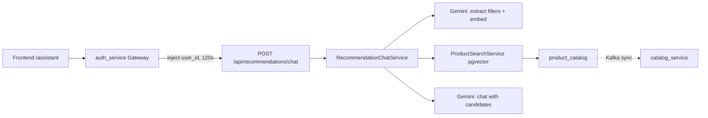
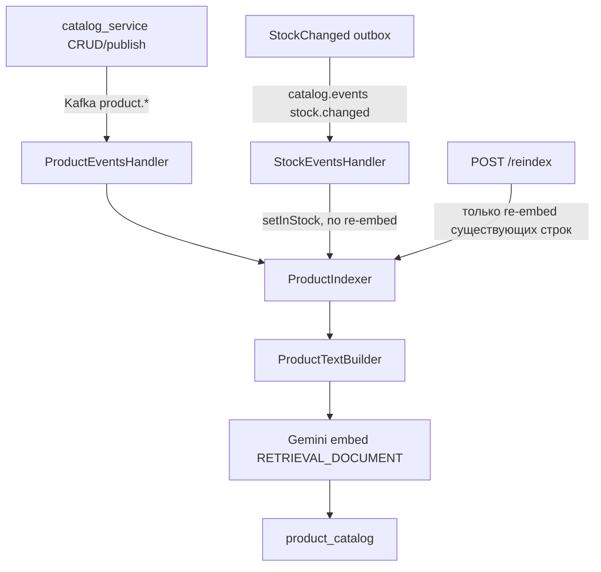

# Recommendation service

Laravel-микросервис **shopping recommendation assistant**: RAG поверх локальной копии каталога в Postgres+pgvector, оркестрация на PHP, LLM — Google Gemini. Function calling / tools у модели **нет** — поиск делает бэкенд, модель только извлекает фильтры и пишет ответ по готовым кандидатам.

---

## Общая архитектура



Ключевые файлы:

- Оркестрация: [`app/Services/Chat/RecommendationChatService.php`](app/Services/Chat/RecommendationChatService.php)
- Поиск: [`app/Services/Catalog/ProductSearchService.php`](app/Services/Catalog/ProductSearchService.php)
- LLM: [`app/Services/Llm/Gemini/GeminiLlmClient.php`](app/Services/Llm/Gemini/GeminiLlmClient.php)
- Карточки/path: [`app/Models/ProductCatalog.php`](app/Models/ProductCatalog.php) → `toCardArray()`
- UI: [`../frontend/src/Pages/Assistant.jsx`](../frontend/src/Pages/Assistant.jsx)

---

## 1. Цепочка HTTP-запроса (от клика до ответа)

### Frontend

1. Пользователь на `/assistant` ([`../frontend/src/App.jsx`](../frontend/src/App.jsx), auth required).
2. [`Assistant.jsx`](../frontend/src/Pages/Assistant.jsx) шлёт:
   - `POST /api/recommendations/chat` — `{ message, conversation_id? }`
   - `GET /api/recommendations/conversations/{id}` — восстановление истории
   - `DELETE /api/recommendations/conversations/{id}` — новый диалог
3. `conversation_id` хранится в `sessionStorage` (`assistant_conversation_id`).
4. Браузер **не** передаёт `user_id` — его подставляет gateway.

### Gateway (`auth_service`)

- JWT middleware → `GatewayController::recommendations`
- Прокси на `{RECOMMENDATION_SERVICE_URL}/api/recommendations/...`
- `ProxyService` вшивает `user_id` в body/query
- Таймаут чата **120s** (LLM медленный)

### Recommendation API

Маршруты в [`routes/api.php`](routes/api.php) (префикс Laravel `/api`):

| Метод | Путь | Контроллер |
|-------|------|------------|
| POST | `/recommendations/chat` | `ChatController` |
| GET/DELETE | `/recommendations/conversations/{id}` | `ConversationController` |
| POST | `/recommendations/reindex` | `ReindexController` (admin через gateway) |
| GET | `/recommendations/health` | `HealthController` |

`ChatController` валидирует через `ChatRequest` и вызывает `RecommendationChatService::chat()`.

### Ответ клиенту

```json
{
  "conversation_id": "uuid",
  "answer": "текстовый ответ ассистента",
  "extracted_filters": { "store_id": null, "store_name": null, "category_name": null, "query": "...", "attributes": [] },
  "products": [ { "product_id": 42, "name": "...", "path": "/products/42", ... } ]
}
```

---

## 2. Пайплайн одного сообщения чата (пошагово)

Внутри `RecommendationChatService::chat()`:

1. **Диалог** — найти активный по `conversation_id`+`user_id`+`expires_at > now()`, иначе создать новый.
2. **История** — последние **6** сообщений (`HISTORY_LIMIT`) для контекста LLM.
3. **Сохранить** user message в `messages`.
4. **Фильтры + embedding**:
   - Если клиент передал structured-фильтры (`category_name|in_stock|price_*`) → без extract, только `embed(message)`.
   - Иначе → `extractFilters`, затем `embed(filters.query ?: message)`. `store_id` с UI мержится, но extract не отключает.
5. **normalize** — default `in_stock=true` (config); merge клиентских полей.
6. **Поиск** → `SearchHit[]` (product + cosine distance; attributes — soft re-rank в PHP, не жёсткий SQL) → **RelevanceGate** (порог cosine distance, default `RECOMMENDATION_MAX_COSINE_DISTANCE=0.75`) → **ProductFreshnessChecker** (Catalog API).
7. **Карточки** — `toCardArray()` (включая `path`).
8. **Промпт к LLM** — история + текущий user turn с блоком кандидатов:

   ```
   {message}

   Candidates:
   1. Name | 1999 ₽ | магазин: ТЦ Галерея
   ...
   ```

9. **Ответ** — `llm->chat(..., SYSTEM_PROMPT)`, сохранить assistant message **с `products` JSON**, `touchActivity()`.
10. Вернуть JSON с `answer` + `products`.

System prompt ассистента: краткий ответ по-русски (имя/цена/магазин), без сырых `/products/...` — карточки уже в UI.

Модель **не ищет** товары сама — только рассуждает по списку, который уже нашёл PHP.

---

## 3. Как работает поиск (где и что ищется)

### Локальный индекс `product_catalog`

Не live-запрос в catalog_service. Своя таблица с денормализованными полями + `embedding vector(768)`.

Фильтры в SQL ([`ProductSearchService`](app/Services/Catalog/ProductSearchService.php)):

- всегда: `is_published = true`, `embedding IS NOT NULL`
- опционально: `store_id` и/или `store_name` / `category_name` (ILIKE, case-insensitive, ё→е), `in_stock`, `price` min/max
- attributes: **не** в SQL; после vector top-k — soft re-rank в PHP (ё→е, обрезка окончаний; размер «от N» → `>= N`)
- сортировка: cosine distance `embedding <=> ?::vector`, затем boost по числу совпавших attributes

Вектор запроса: embedding очищенного `filters.query` (после extract), либо `embed(message)` при клиентских фильтрах / fallback `"recommended products"`.

### Откуда берутся товары (индексация)



- Consumers: `kafka:consume:product-events`, `kafka:consume:stock-events`
- Текст для эмбеддинга ([`ProductTextBuilder`](app/Services/Catalog/ProductTextBuilder.php)): `store`, `name`, `description`, `category`, attributes (без ID и флагов stock/publish)
- Stock меняет только `in_stock` без пересчёта вектора
- `reindex` **не тянет** каталог извне — только переэмбеддит то, что уже есть; наполнение — через Kafka / `RepublishProductsSeeder` в catalog
- Поле `store_name` заполняется из Kafka (`store.name`); после миграции нужен republish существующих товаров

---

## 4. Как ИИ «даёт ссылки» и куда реально кликают

Здесь два канала — важно не путать.

### A. Структурированные карточки (основной UX перехода)

`ProductCatalog::toCardArray()` жёстко ставит:

```php
'path' => '/products/'.$this->product_id,
```

Массив `products` уходит в JSON ответа.

Фронт в [`Assistant.jsx`](../frontend/src/Pages/Assistant.jsx) рендерит кликабельные карточки:

```jsx
<Link to={`/products/${product.product_id}`}>
```

Навигация идёт по `product_id` в SPA-роут `/products/:id` → `ProductPage` грузит товар из catalog API. Поле `path` с бэка совпадает с этим маршрутом, но UI его напрямую не читает.

Карточки сохраняются в `messages.products` (jsonb) вместе с ответом ассистента и возвращаются в `GET /conversations/{id}`, поэтому переживают reload и возврат со страницы товара.

### B. Текст ответа без сырых path

Кандидаты в промпт идут без `/products/...` (имя, цена, магазин). System prompt просит не писать path — переход по товарам только через карточки в UI.

---

## 5. LLM-слой (три режима Gemini)

Контракт [`LlmClient`](app/Services/Llm/Contracts/LlmClient.php), биндинг в `AppServiceProvider` при `LLM_DRIVER=gemini`.

| Метод | API | Назначение |
|-------|-----|------------|
| `embed` | `embedContent` | Векторы; `RETRIEVAL_QUERY` (чат) / `RETRIEVAL_DOCUMENT` (индекс); dim 768 |
| `extractFilters` | `generateContent` + `responseMimeType: application/json` | Фильтры поиска |
| `chat` | `generateContent` | Текстовый ответ ассистента |

Filter system prompt извлекает: `store_id` (только если пользователь явно назвал число), `store_name`, `category_name`, `in_stock`, `price_min/max`, `query` (тип товара без цвета), `attributes[]` (русские имена: Цвет, Размер, …).

Конфиг: [`config/llm.php`](config/llm.php) — `GEMINI_API_KEY`, `GEMINI_CHAT_MODEL` (default `gemini-3.8-flash`), `GEMINI_EMBEDDING_MODEL` (`gemini-embedding-001`), temperature `0.3`.

---

## 6. Диалоги и TTL

- Таблицы: `conversations` (uuid, user_id, last_activity_at, expires_at), `messages` (role user|assistant, content, products jsonb, cascade delete)
- Hard TTL **24h** от создания, idle **30m** от активности → `expires_at = min(hard, idle)`
- Cleanup: `conversations:cleanup` каждую минуту (`routes/console.php`)
- Доступ только владельцу и только к не истёкшим

---

## 7. Что важно понимать про систему

- Это **не** поиск по полному catalog_service в runtime — только локальный снимок + семантика.
- Без Kafka-консьюмеров ассистент «пустой»; без Gemini — падает на embed/chat.
- Ссылки на товары — SPA-пути `/products/{id}`, не внешние URL магазинов.
- Клиентские фильтры (`store_id` / `store_name` / `category_name` / цена / stock) отключают LLM-extract и оставляют только embed.
- После обновления индексатора нужен restart kafka product consumer и republish, иначе `store_name` останется NULL.
