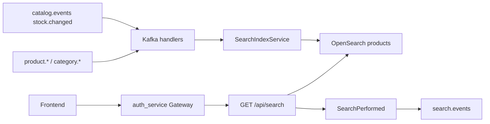

# Search service

Laravel-микросервис **поиска по каталогу**: индексирует product/category/stock события из Kafka в OpenSearch и отдаёт HTTP search / autocomplete. Собственной SQL-БД каталога нет — источник правды для документов — Kafka + OpenSearch.

---

## Общая архитектура



Ключевые файлы:

- Search DSL / mapping: [`app/Search/`](app/Search/)
- Index lifecycle + writers: [`app/Indexing/`](app/Indexing/)
- Facades: [`ProductSearchService`](app/Services/ProductSearchService.php), [`SearchIndexService`](app/Services/SearchIndexService.php)
- Routes: [`routes/api.php`](routes/api.php)
- Workers: `kafka:consume:product-events`, `kafka:consume:category-events`, `kafka:consume:stock-events`, `opensearch:setup` ([`compose.yml`](compose.yml))

---

## Trust model (auth)

**JWT проверяет только `auth_service` gateway.** Search service не валидирует токены.

1. Публичный read catalog search идёт через gateway на `/api/search*`.
2. Сервис слушает `:8005` только во внутренней Docker-сети (`expose`); публичный вход — через gateway.
3. Defense-in-depth: Laravel `throttle:search` (см. `SEARCH_THROTTLE_PER_MINUTE`) и caps на `page` / filter fan-out.
4. Прямой вызов с mesh без gateway — assumption периметра (как у order_service).

---

## Индексы OpenSearch

| Index | Роль |
|-------|------|
| `products` | Основной search/autocomplete индекс (text + nested attributes + stock) |
| `categories` | Write-side denorm из category events; **search API его не читает** |

Facets категорий берутся с denormalized `category_id` / `category_name` на product docs, не из индекса `categories`.

Analyzers: `product_index` (index-time) и `product_search` (search-time + `synonym_graph`). Синонимы — `OPENSEARCH_PRODUCT_SYNONYMS` / [`config/opensearch.php`](config/opensearch.php).

---

## HTTP API

Префикс Laravel `/api`. CSRF exemption для `api/*`. Middleware: `throttle:search`.

| Method | Path | Назначение |
|--------|------|------------|
| GET | `/search` | Поиск + global facets + pagination |
| GET | `/search/autocomplete` | Prefix suggestions по `name.autocomplete` |

### Query params (`/search`)

| Param | Notes |
|-------|--------|
| `q` | string, max 255; empty → `match_all` |
| `category_id` | scalar или array, max 50 ids |
| `min_price` / `max_price` | numeric ≥ 0 |
| `in_stock` | bool-like (`1`/`0`/`true`/`false`) |
| `attr[Name]` | multi-value; max 20 keys, 20 values/key, 64 chars |
| `page` | 1…200 |
| `per_page` | 1…50 |
| `sort` | `relevance` \| `price_asc` \| `price_desc` \| `new` |

Ответ: Laravel-style `products` pagination + `facets` + `applied`.

### Важные семантики поиска

- **Global facets + `post_filter`**: фильтры режут hits, sidebar facets всегда по всему каталогу.
- **Attribute multi-value = AND**: каждое значение — отдельный nested clause.
- **`track_total_hits`**: bound (`OPENSEARCH_TRACK_TOTAL_HITS`, default 10000), не `true`.
- После успешного search диспатчится `SearchPerformed` → Kafka `search.events` (`search.performed`). Header `X-Skip-Analytics` учитывается только при `ALLOW_SKIP_ANALYTICS=true`.

---

## Kafka

**Consume**

| Topics | Handler | Index effect |
|--------|---------|--------------|
| `product.created`, `product.updated`, `product.published`, `product.unpublished` на топике `product.events` | `ProductEventsHandler` | поля каталога; `quantity` / `in_stock` не затираются, если документ уже есть |
| `product.deleted` на том же топике | same | удаление документа |
| `product.deleted` | same | delete product doc |
| `category.created` / `updated` | `CategoryEventsHandler` | index category; на update ещё `updateByQuery` `category_name` на products |
| `category.deleted` | same | delete category doc (products не удаляются) |
| `catalog.events` (`stock.changed`) | `StockEventsHandler` | partial update `quantity` / `in_stock`; skip если product doc отсутствует |

Event type: header `event-type`, иначе body `event`.

**Produce**

| Topic | Event |
|-------|--------|
| `search.events` | `search.performed` (analytics; publish failure не ломает HTTP ответ) |

Инвариант: **`product.updated` не затирает stock**, пришедший через `stock.changed` (partial catalog update).

---

## Workers / local run

Из [`compose.yml`](compose.yml):

- `search_app` — HTTP
- `search_opensearch` — `:9200` (security plugin **выключен** для local; не экспонировать в prod без auth)
- `search_kafka_*_consumer` — product / category / stock consumers
- `opensearch:setup` — создать/пересоздать индексы

```bash
# unit + feature
docker compose exec search_app php artisan test

# integration (real OpenSearch)
docker compose exec search_app php artisan test -c phpunit.integration.xml
```

---

## Security notes

| Control | Config / code |
|---------|----------------|
| Rate limit | `throttle:search`, `SEARCH_THROTTLE_PER_MINUTE` |
| Deep pagination | `page` max 200 |
| Filter fan-out | caps на `category_id` / `attr` |
| Exact total cost | `OPENSEARCH_TRACK_TOTAL_HITS` |
| Write refresh | `OPENSEARCH_REFRESH_ON_WRITE` (default false; true в тестах) |
| Skip analytics | `ALLOW_SKIP_ANALYTICS` |
| Query injection | structured DSL only (нет `query_string`) |

---

## Карта классов

| Path | Role |
|------|------|
| `app/Search/ProductSearchQueryBuilder.php` | text / filters / sort / facet aggs |
| `app/Search/ProductSearchResponseMapper.php` | hits + facets → API shape |
| `app/Search/ProductAutocompleteQuery.php` | autocomplete body + suggestions |
| `app/Indexing/OpenSearchIndexManager.php` | ensure / recreate / mappings |
| `app/Indexing/ProductDocumentWriter.php` | product index/update/delete/stock |
| `app/Indexing/CategoryDocumentWriter.php` | category CRUD + name sync |
| `app/Services/ProductSearchService.php` | HTTP search orchestration |
| `app/Services/SearchIndexService.php` | facade for handlers/tests |
| `app/Kafka/Handlers/*` | Kafka → index |
| `app/Console/Commands/KafkaConsume*.php` | long-running consumers |
